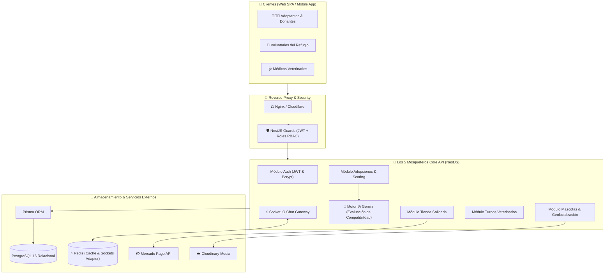
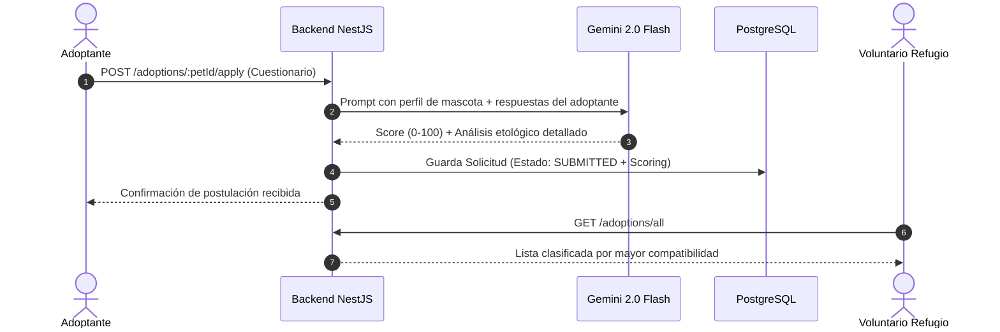
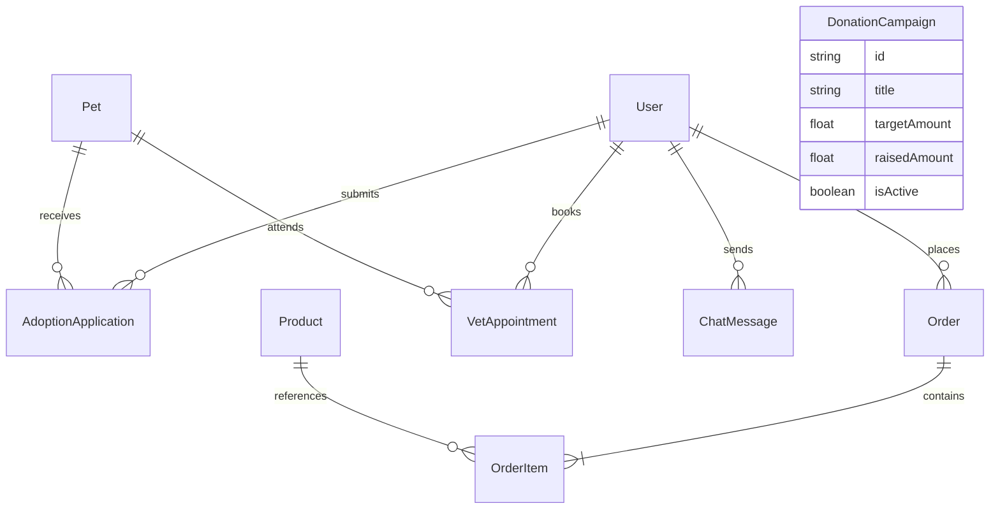

# 🐾 Los 5 Mosqueteros — Enterprise Pet Rescue, AI Adoption & Care Ecosystem

[](https://nestjs.com/)
[](https://www.typescriptlang.org/)
[](https://www.postgresql.org/)
[](https://www.prisma.io/)
[](https://redis.io/)
[](https://ai.google.dev/)
[](https://www.mercadopago.com.ar/)
[](https://socket.io/)
[](http://localhost:3000/docs)
[](https://www.docker.com/)

**Los 5 Mosqueteros** es una plataforma backend de alto rendimiento orientada a la protección y rescate animal, que fusiona un **motor inteligente de evaluación de compatibilidad de adopciones con IA (Google Gemini)**, gestión de turnos veterinarios, canal de chat en tiempo real por WebSockets y una **tienda solidaria con checkout de Mercado Pago** para el financiamiento de cirugías y refugios.

---

## 🏛️ Arquitectura del Sistema



---

## 🐶 Los 5 Módulos Principales

### 1. 🤖 Motor de Compatibilidad de Adopción con IA (Gemini 2.0)
- Evalúa el estilo de vida del adoptante (tipo de hogar, patio, horas en soledad, otros animales y niños) cruzándolo con el perfil bioconductual de la mascota (energía, tamaño, traumas y necesidades).
- Genera un **Scoring de Compatibilidad (0 a 100)** y un informe etológico descriptivo para que el refugio tome decisiones informadas y reduzca las tasas de devolución.



### 2. 📍 Rescate & Localización de Mascotas
- Publicación de animales en adopción o extraviados con fotos múltiples y georreferenciación (latitud/longitud).
- Filtros avanzados por especie (perros, gatos, otros), tamaño, nivel de energía y estado.

### 3. 🛒 Tienda Solidaria & Checkout Transaccional
- Catálogo de insumos para mascotas donde el 100% de los beneficios financia rescates.
- Manejo transaccional estricto con control y reserva de stock (`$transaction`).
- Generación de preferencias de pago con **Mercado Pago Checkout Pro**.

### 4. 🩺 Turnos Veterinarios & Campañas de Castración
- Gestión de citas para vacunación, cirugías y desparasitación con historial médico.
- Campañas de donación colectiva (Crowdfunding médico) con barra de progreso en vivo.

### 5. 💬 Chat en Tiempo Real (Socket.io)
- Canal de mensajería instantánea bidireccional entre postulantes a adopción y los cuidadores del refugio.

---

## 🗄️ Modelo Entidad-Relación



---

## 🛠️ Instalación y Puesta en Marcha

### Con Docker Compose (Recomendado)

```bash
# 1. Clonar el repositorio
git clone https://github.com/mauro8778/los-5-mosqueteros.git
cd los-5-mosqueteros

# 2. Levantar la infraestructura completa (PostgreSQL + Redis + API)
docker compose up --build -d
```
* **API REST:** `http://localhost:3000`
* **Swagger OpenAPI:** `http://localhost:3000/docs`

---

### Desarrollo Local

#### Requisitos
- **Node.js:** >= 20.x
- **PostgreSQL:** >= 15.x
- **Redis:** >= 6.x

```bash
# 1. Instalar dependencias
npm install

# 2. Variables de entorno
cp .env.example .env

# 3. Aplicar modelo a la base de datos
npx prisma db push

# 4. Iniciar en modo desarrollo con Hot-Reload
npm run start:dev
```

---

## 📡 Endpoints Destacados de la API

| Módulo | Método | Endpoint | Descripción |
| :--- | :--- | :--- | :--- |
| **Auth** | `POST` | `/auth/register` | Registro de adoptantes |
| **Auth** | `POST` | `/auth/login` | Login y emisión de JWT |
| **Mascotas** | `GET` | `/pets` | Búsqueda filtrada de mascotas |
| **Mascotas** | `POST` | `/pets` | Publicar nuevo rescate (Admin/Voluntario) |
| **Adopciones** | `POST` | `/adoptions/:petId/apply` | Postulación con scoring IA en vivo |
| **Adopciones** | `GET` | `/adoptions/all` | Auditoría de solicitudes con IA |
| **Tienda** | `GET` | `/store/products` | Catálogo de productos solidarios |
| **Tienda** | `POST` | `/store/orders` | Checkout con Mercado Pago |
| **Donaciones** | `GET` | `/donations/campaigns` | Campañas de recaudación activas |
| **Veterinaria** | `POST` | `/appointments` | Reserva de turno clínico |

---

## 📄 Licencia

Este proyecto está bajo la Licencia MIT.
