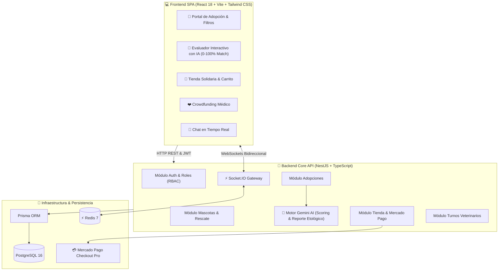

# 🐾 Los 5 Mosqueteros — Fullstack Ecosystem for Pet Rescue, AI Adoption & Care

[](https://react.dev/)
[](https://vitejs.dev/)
[](https://tailwindcss.com/)
[](https://nestjs.com/)
[](https://www.typescriptlang.org/)
[](https://www.postgresql.org/)
[](https://www.prisma.io/)
[](https://ai.google.dev/)
[](https://www.mercadopago.com.ar/)
[](https://socket.io/)
[](https://www.docker.com/)

**Los 5 Mosqueteros** es una plataforma fullstack empresarial orientada al rescate, protección y bienestar animal. Integra una aplicación web moderna (React + Vite + Tailwind) y un backend de alto rendimiento (NestJS + Prisma + PostgreSQL) con un **motor etológico de evaluación de compatibilidad de adopciones con Inteligencia Artificial (Google Gemini)**, tienda solidaria con checkout de Mercado Pago, turnos veterinarios y chat en tiempo real por WebSockets.

---

## 🏛️ Arquitectura del Sistema



---

## 🌟 Funcionalidades Fullstack

### 1. 🤖 Evaluación de Compatibilidad de Adopción con IA
- El adoptante responde un cuestionario sobre su tipo de vivienda, disponibilidad horaria, niños y otros animales.
- El backend procesa el perfil con **Google Gemini 2.0 Flash**, calculando un porcentaje de compatibilidad y un análisis etológico detallado que se visualiza en la interfaz.

### 2. 🐶 Fichas Interactivas de Mascotas
- Catálogo de rescates con las 5 mascotas emblemáticas (*D’Artagnan, Athos, Porthos, Aramis y Milady*).
- Filtros rápidos por especie (perros / gatos), badges de vacunación, castración y nivel de actividad.

### 3. 🛒 Tienda Solidaria Transaccional
- Catálogo de insumos con carrito flotante, control de inventario y botón directo para **Mercado Pago Checkout Pro**.

### 4. ❤️ Crowdfunding para Cirugías
- Campañas de recaudación médica con barras de progreso en tiempo real y donaciones instantáneas.

### 5. 🩺 Turnos Veterinarios & Chat en Vivo
- Formulario de reserva de castraciones y consultas.
- Widget flotante de chat bidireccional por WebSockets con voluntarios del refugio.

---

## 🚀 Estructura del Monorepo

```
los-5-mosqueteros/
├── backend/                  # API REST & WebSockets (NestJS + TypeScript)
│   ├── src/
│   │   ├── adoptions/        # Solicitudes de adopción
│   │   ├── ai-match/         # Integración con Google Gemini AI
│   │   ├── appointments/     # Turnos veterinarios
│   │   ├── auth/             # JWT, Bcrypt, Guards & Roles
│   │   ├── chat/             # Gateway Socket.io
│   │   ├── donations/        # Campañas solidarias
│   │   ├── pets/             # Fichas de animales rescatados
│   │   ├── prisma/           # Servicio y cliente de base de datos
│   │   └── store/            # Carrito y órdenes
│   ├── prisma/               # Esquema relacional PostgreSQL
│   └── Dockerfile            # Construcción multi-stage
│
├── frontend/                 # Aplicación Web SPA (React + Vite + Tailwind)
│   ├── src/
│   │   ├── components/       # UI (Navbar, Hero, PetList, AiMatchModal, Store, etc.)
│   │   ├── services/         # Clientes Axios y conexión Socket.io
│   │   └── types/            # Interfaces TypeScript
│   └── vite.config.ts
│
├── docker-compose.yml        # Orquestación (Postgres + Redis + Backend)
└── package.json              # Scripts para ejecutar ambos servicios
```

---

## 🛠️ Instalación y Uso Rápido

### Desarrollo Local (Recomendado)

#### 1. Iniciar Backend
```bash
cd backend
npm install
cp .env.example .env
npm run start:dev
```
Backend disponible en `http://localhost:3000` (Swagger en `http://localhost:3000/docs`).

#### 2. Iniciar Frontend
En una nueva terminal:
```bash
cd frontend
npm install
npm run dev
```
Frontend disponible en `http://localhost:5173`.

---

### Despliegue con Docker Compose

```bash
docker compose up --build -d
```

---

## 📄 Licencia

Este proyecto está bajo la Licencia MIT.
